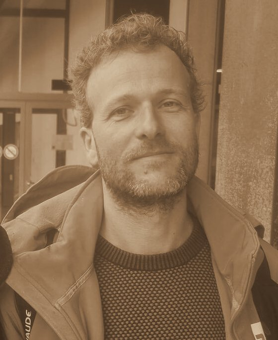

DE GROTE OEMTA BEDANKINGSSHOW - het boek als website
=====================================================

Inhoud van deze map
  index.html                 het boek (HTML, CSS en JavaScript in één bestand)
  img/                       alle foto's en affiches
  css/                       de opmaak (main.css) en de lettertypes (fonts.css)
  fonts/                     EB Garamond en IM Fell English (SIL Open Font License)
  js/page-flip.browser.js    de bibliotheek die de bladzijden laat omslaan (StPageFlip 2.0.7, MIT-licentie)

Online zetten
  Upload de hele map (index.html + css + fonts + img + js) naar je webhosting, bv. via FTP,
  Netlify Drop (app.netlify.com/drop), GitHub Pages of de website van de Oemtata.
  Open daarna het adres van index.html in je browser.

Lokaal bekijken
  Dubbelklik op index.html. De lettertypes staan in de map fonts/, dus het boek
  ziet er ook zonder internet goed uit.

Bedienen
  Pijltjes of spatie: volgende/vorige bladzijde. Klik of sleep een hoek om om te slaan.
  Knop "Programma" springt naar de inhoud. Knop ⛶ = volledig scherm.

Een foto toevoegen in een lege lijst
  1. Zet de foto in de map img/, bv. img/sven.jpg
  2. Zoek in index.html de lijst, bv. data-slot="sven"
  3. Haal het woord "empty" weg uit class="plate oval empty"
  4. Vervang  door 

  Lege lijsten: sarco, kermis80, financien, vzw-frank, vzw-jannes, vzw-shayna.

Tekst aanpassen
  Open index.html in een teksteditor (bv. Kladblok, TextEdit of VS Code) en pas
  de tekst tussen de tags aan. De knop "Tekst bewerken" en "+ Foto" werken alleen
  in de versie op Claude, niet op een eigen website.
